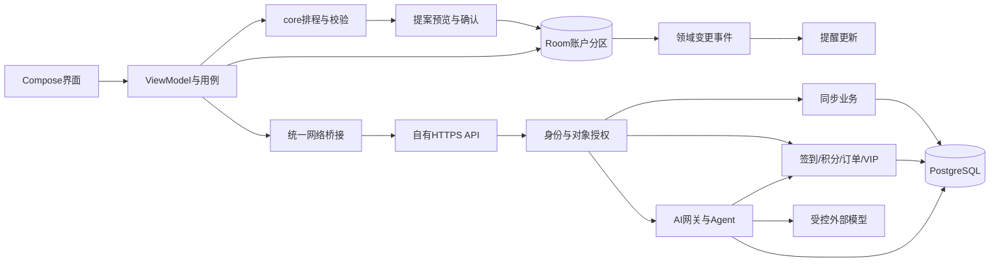

# 架构与技术栈

版本：0.2。客户端已有首轮本地实现；账户、积分、支付与AI网关为设计，尚无已部署服务器。依赖版本见 `env/toolchain.json`。

## 总体方案

- Android：Kotlin、Compose、Material3、ViewModel、协程Flow，单向数据流。
- core：纯Kotlin业务规则、区间、工时与排程，不依赖设备、数据库或网络。
- 本地数据：Room与事务；账户数据分区、访客迁入需用户选择；凭据与普通记录分离。
- 服务：先一个后端＋PostgreSQL，模块分身份、同步、积分／订单、AI业务；具体语言／框架由双方在实现前定稿，避免两套实现并行。
- 网络：Weiding维护客户端传输、身份刷新、统一错误与同步；客户端只连自有API。Bottledkzk维护服务器AI业务、模型路由与提案约束，模型凭据仅服务端持有。
- 提醒／分享：Weiding实现权限、通知和改期取消、相册／相机、图片模板／保存与平台调用，遵循共同UI规范。
- 网站／部署：Bottledkzk主责介绍下载页、域名／HTTPS与数据库部署设计，Weiding配合API联调；静态页面不承担身份认证。

图中服务端节点是计划，不代表已上线。APP不能把用户提供的Key或任意URL发给服务器转接；服务端模型目录与权限控制对全部AI模式生效。

## 数据与交易边界

UI不直接写SQL。排程先计算候选，再按快照／版本校验并事务应用，保护已完成、历史和固定安排。AI提案先做服务端与本地校验，再由用户确认；付款、积分和权限不在Agent工具白名单。

服务端是身份、积分、订单与权益的唯一权威。签到唯一约束、消费预占／结算、支付事件与权益发放使用统一幂等和事务机制。同步携带版本、游标与删除标记，不允许客户端回写权威余额。

## 取舍与实施顺序

Compose统一状态与适配；Room提供本地持久化，数据库升级需迁移；core便于讲解算法和边界测试。服务端保持课程规模，先约定清晰API和对象归属，不引入微服务或任意代码Agent。

实施顺序：本地流程→双方契约→身份与积分→真实AI及模块并行→服务集成→双方真机与答辩。真实服务器／域名未齐期间可使用本地服务和明确标记的模拟接口，但不改变必须通过服务器调用AI的产品约束。

[分工与协作方案](分工与协作方案.md) · [接口与数据契约草案](接口与数据契约草案.md) · [账户与安全](账户-AI积分与安全方案.md)
