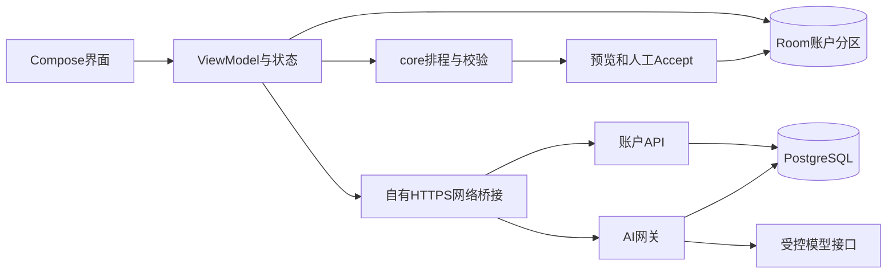

# 架构与技术栈

版本0.5，2026-10-31。描述0.5.4交付使用的实现；部署与验收见[发布记录](../Bottledkzk/2026-10-31-0.5.4交付与验收.md)

## 技术选择

| 层 | 实际技术 | 作用与取舍 |
| --- | --- | --- |
| Android交互 | Kotlin2.2.21、Compose BOM2025.10.01、Material3 | 声明式界面，以状态驱动五个主要目的地 |
| 状态与异步 | ViewModel、StateFlow、协程 | 统一界面状态，隔离账户会话与在途请求 |
| 领域规则 | 纯Kotlin core | 不依赖Android，可单独验证区间与排程约束 |
| 本地存储 | Room2.8.3，schema6 | 事项、安排、打卡、日记、会话按owner分区，事务应用 |
| 网络 | HttpURLConnection、kotlinx.serialization | 只访问自有HTTPS API，统一错误与原ID恢复；未使用Retrofit作为传输层 |
| 服务端 | Node24、TypeScript、Fastify5、Prisma6、pg | 账户API与AI网关分进程，Schema白名单与事务业务 |
| 数据库 | PostgreSQL16、前向迁移、参数化SQL、RLS | 内容归属、受限角色、钱包及订单幂等约束 |
| 系统与媒体 | AlarmManager、通知渠道、系统图片选择器／相机、FileProvider、MediaStore | 权限按系统能力处理，生成PNG并显式分享 |
| 发布 | HTML/CSS/JS、Nginx、systemd、GitHub Releases | 固定证书APK、版本目录、读回校验、原子切换与回退 |

## 排程与受控 Agent

模型解释意图并生成建议，本地确定性排程负责计算实际时间。先按截止和重要度安排可用预算，合并忙碌区间、扣除不可用时段，保护固定／已开始／完成安排；跨任务累计连续工作，必要时插入休息。不可行时保留未安排量并说明冲突，不宣称全局最优

计划建议的时间线与候选安排分开校验，Accept前再次核对当前账户、登录会话、VIP、数据快照和时间约束，一次Room事务落库。明确跨日移动还会绑定原对象与指定日期，避免模型毫秒计算或对象选择错误。模型不能执行SQL、付款、增分或授予VIP

日记只根据指定当地日期的打卡事实和用户明确事实生成，文学／严谨／精简／详细改变表达，不扩大事实。服务端检查正文、去独立注释、拦截已发现的虚构修饰，失败不交付保存草稿；有限词法守卫不等于通用语义真值证明

## 数据与网络边界

访客与每个账号在本地分区；登录只切换分区，不自动上传或导入日程。个人资料中的昵称、motto和日记跟随账户同步，前台协调器保留离线差异与冲突；助手会话和本地图片URI不上传。VIP日程备份／覆盖／兼容同步均需主动预览确认

服务器是身份、钱包、订单、VIP的权威。AI请求先验权与预占，再调用模型，按真实用量结算；明确失败释放，未知结果保留原ID查询，不能以重复提交制造重复费用。MOCK支付也是服务器订单状态机与一次权益发放，不是客户端直接改余额

## 维护与限制

账户运行、AI运行和迁移角色分离，数据库仅回环；迁移只追加，备份需恢复演练。生产与官网使用版本目录和可回退指针，发布附件读回后才切入口。没有引入任意工具执行、微服务集群、CRDT或真实收单
