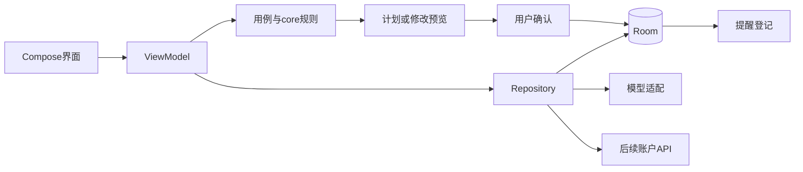

# 架构与技术栈

状态：首轮基线草案；依赖版本固定在 `env/toolchain.json`，通过构建后才记录为本机已验证。

## 方案

- Android：Kotlin、Jetpack Compose、Material3、ViewModel与协程Flow，单向数据流。
- 核心：独立纯Kotlin `core` 模块，包含数据规则、区间、工时和排程，可在无设备时执行单元测试。
- 数据：Room本地数据库与事务；本地设置与凭据分开，敏感凭据使用Android Keystore支持的保护方式。
- 提醒：Android通知渠道和可撤销提醒登记；精确提醒与后台工作按系统职责分别选择。
- 网络：通用模型适配与受控Agent操作；账户接口与模型接口分开，客户端不拥有服务器私钥。
- 网站：响应式静态下载页先行；后续账户服务通过HTTPS API连接，不假装静态页面已具备认证能力。
- 后端候选：Kotlin／Java或TypeScript服务＋PostgreSQL，由负责人认领时比较团队熟悉度、部署成本与接口一致性后定稿。

UI不直接拼SQL或写数据库；排程不依赖Compose、网络或数据库实例。先计算候选计划，再以事务替换可移动部分；固定、完成和历史记录有独立保护。AI只返回受限操作，不能执行系统命令或直接操作数据库。

## 技术取舍

Compose便于统一状态与适配，代价是需要理解重组和生命周期；Room提供持久化与事务，数据库模式变化需要迁移；纯Kotlin core方便解释算法和做边界测试。模块数量先保持精简，不为答辩堆叠无用框架。账户同步在身份与冲突协议确定后接入，避免先写一套无法隔离账户的接口。

## 分步交付

1. 工程骨架与可复现构建。
2. 纯Kotlin调度规则和边界测试。
3. 本地数据库、快速录入、计划与打卡界面。
4. 提醒、完整日历、AI会话与提案确认。
5. 分享、网站、账户服务及适配验收。

每步提交必须说明本次可验证能力和仍未接通的接口，不把预留类或按钮写成完成。
