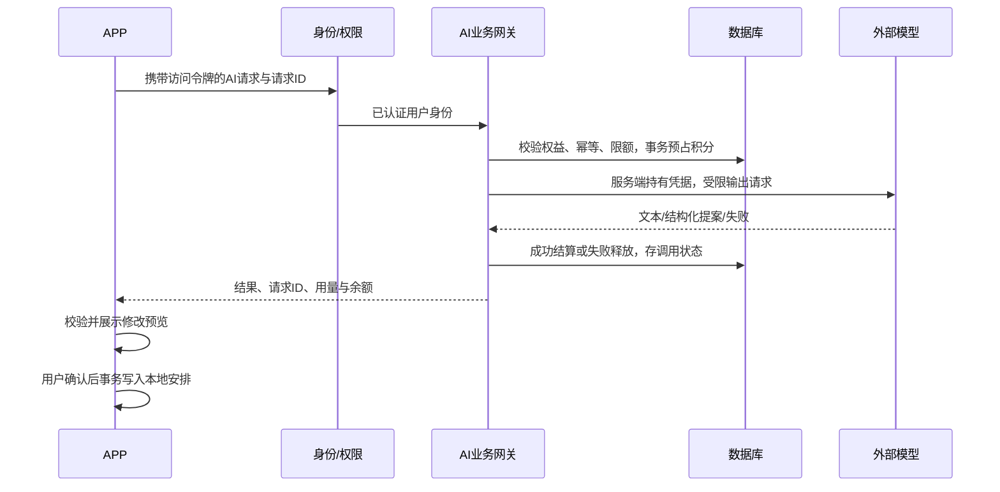

# 账户、AI积分与安全方案

版本：0.2　状态：设计方案，尚未实现服务端；不代表已开通登录、真实AI、VIP或收款。具体积分数、套餐价格、VIP权限、服务器和域名待后续确认。

## 1. 最小课程范围

客户端本地基础功能可访客使用。AI服务、签到积分、VIP、支付和云同步必须登录WhaleToDo；用户不能填写供应商API Key。用一个后端服务和PostgreSQL满足首轮需求，不引入微服务、复杂推荐、防作弊模型或自建支付网络。后端语言由双方在开始实现前选定并固定，不同时维护两套。

2026-10-30项目发起人决定：所有账号统一使用MOCK充值，有明确“模拟支付／无真实资金”标识；正式账号、订单和权益继续存于生产PG。设计保留真实支付适配位置；未取得条件不收款、不收集银行卡信息、不把测试订单展示为真实交易。

## 2. 身份与信息存储

- 最少资料：用户ID、唯一用户名、密码哈希、可选昵称、状态与创建／更新时间。首轮不要求身份证、通讯录、真实姓名、手机号或银行卡。
- 使用成熟库的Argon2id密码哈希及独立随机盐，参数按部署机器基准确认；不明文、不自写加密算法、不用普通SHA256代替密码哈希。
- 首轮可用短期、不透明访问令牌＋可轮换刷新令牌，服务端只存令牌摘要、有效期与撤销状态。令牌由安全随机源产生；刷新旧令牌作废，重放触发撤销。令牌形式如改JWT，应另明确撤销与密钥轮换，不同时草率混用。
- 手机访问凭据使用系统Keystore支持的保护方式；不保存明文密码。退出／换号清理内存与令牌并隔离本地账户缓存；访客数据迁入需用户选择。服务器认定的用户ID不能被请求体中的userId替换。
- 注册、登录、刷新、退出和账户信息为首轮；找回与注销按可用服务分阶段设计，未提供邮件／短信服务时不假装已完成自动找回。
- 账户资料、任务、会话、积分与订单分表。每个私有对象带owner_user_id；鉴权之后还要检查对象归属，不能只隐藏界面。

## 3. 签到和积分

流程：登录→读取签到状态／余额→签到领取→选择AI功能→服务器验权与预占→调用模型→成功结算或失败释放→返回结果与余额。

| 状态／规则 | 设计 |
| --- | --- |
| 未登录 | 拒绝AI、签到和云端私有数据请求，提示登录 |
| 免费用户 | 每日签到领取积分，按规则获得调用次数；没有可用积分不发起供应商调用 |
| VIP | 后端有效权益带来更多积分或功能权限；数量、周期和能力列表待定，不默认无限使用 |
| 业务日 | 服务端统一时区生成business_date，建议默认Asia/Shanghai；由配置确定，手机改时间不能重复领取 |
| 签到幂等 | 唯一键(user_id,business_date,reward_type)；奖励流水与余额同一事务提交 |
| 并发消费 | 原子检查available余额并预占；账本含request_id唯一键，余额不能为负 |
| 调用结果 | 成功结算一次；失败释放一次；超时／断流记录未知状态并可查询，不盲目重复请求供应商 |
| 上限 | 单用户请求频率、并发、模型输出额度及全站供应商预算上限；VIP同样受安全上限保护 |

建议按“功能／模型档位的固定积分”做首轮扣分，供应商实际token费用另作运维统计。扣分数、奖励数量、余额有效期和退款规则后续定稿，不在客户端写死。供应商失败可能仍产生费用，服务端应记录而不能把积分释放当作供应商未扣费的证据。

账本原则：available与reserved分开，使用奖励、预占、结算、释放、调整事件；保留关联请求和原因。同一事件重试只返回原结果，账本和余额更新必须在数据库事务内完成。不能把APP每次上报的余额直接覆盖服务器余额。

## 4. AI网关和Agent

服务器只允许已配置提供方与模型白名单，不接受客户端传入任意上游URL，防止成为开放代理或访问内部地址。凭据放服务端密钥配置，不能进APK、网页、数据库普通资料列、Git或日志；返回错误不包含上游请求头。

Agent限定为事项、课表／忙碌、计划及复盘等结构化操作。系统提示、工具白名单和业务校验共同限制能力；对话中的文字不授予数据库／管理员权限。支付、积分、VIP、认证和任意代码执行不作为Agent工具。每次提案绑定账户、数据版本和有效期，确认前不静默修改安排。

会话历史按账户仅保存在本机，不建立云端会话列表，不参与日程备份或个人资料同步。网关既有 ai_requests 保留单次请求的状态、用量及结果／提案回执，以支持原请求 ID 查询和防重复扣费；这与会话历史同步分开。默认不上传照片、私密备注或整个数据库；配文用用户选中的摘要，同一登录和积分规则适用于日记、分享短句及计划生成。

## 5. 简化支付与权益

1. 客户端提交服务端已定义的product_id；金额、币种、权益和有效期由服务器商品配置决定。
2. 服务器建订单，关联用户、商品快照、金额、环境和幂等键；同一请求重试不重复建单。
3. 登录用户明确确认本人MOCK订单，金额与权益只取不可变订单快照；不提供客户端任意指定VIP／积分的接口，生产不注册测试webhook。
4. 真实通道接入时，服务器验证通知真实性并向支付方核对状态、订单、商户、金额和币种；核验后才更新订单并发放权益。
5. 支付事件、订单更新与权益发放幂等处理；客户端跳转／SDK回调只用于刷新状态，不能直接加积分或VIP。
6. 订单状态最少为PENDING、PAID、CLOSED、REFUNDED，另保留支付事件状态。延迟、重复和乱序事件需重新核对当前事实，不能简单因页面超时丢弃真实支付。
7. 先不做自动续费、提现、用户间转账或复杂优惠。退款／到期对积分和VIP的影响由规则明确，演示通道不得产生现金债务。

分工：Weiding负责账户与订单业务、支付网络适配和客户端；Bottledkzk负责表约束／迁移、AI扣分业务与部署；双方共同验收账户归属和交易一致性。

## 6. 服务器与网络安全

| 风险 | 首轮控制与验收 |
| --- | --- |
| 账户越权 | 所有私有对象查询加归属条件；用A账户访问B事项、订单、会话必须失败 |
| 密码／令牌泄漏 | 成熟哈希库、令牌摘要与轮换、敏感日志过滤；备份同样保护；不公开配置文件 |
| AI费用被刷 | 登录、IP／账户分层限流、并发／输入／输出限制、积分事务、全站预算熔断与告警 |
| 注入／任意上游 | 参数化SQL、白名单字段、受限上传类型／尺寸、模型路由白名单，禁止任意URL转发 |
| 伪造支付／重复奖励 | 本人订单、服务端快照、唯一约束、幂等状态机；生产仅开放显式MOCK确认，测试webhook禁用 |
| 暴露数据库与管理端 | 公网仅开放必要HTTPS入口，数据库留私有网络；服务账户最小权限；管理操作单独认证与审计 |
| 传输与浏览器风险 | 正式域名使用可信TLS，验证证书；跨域允许明确来源，CORS不代替鉴权；若使用Cookie需同时处理CSRF、Secure、HttpOnly、SameSite |
| 依赖／部署问题 | 固定版本、更新安全补丁、非root运行、密钥环境隔离、健康检查与可回滚版本 |
| 数据损失 | 加密备份、访问限制、保留期限与一次恢复演练；迁移前备份，失败不覆盖原库 |
| 调试／上传泄漏 | 生产禁用调试端点、测试webhook和不必要文档入口；照片优先在本地处理，删除EXIF等无关元数据后按需分享 |

登录错误避免泄露账号是否存在；注册／登录／刷新和恢复流程需节流。日志只留请求ID、用户内部ID、状态和用量等必要字段，不记密码、令牌、模型Key和完整会话。管理员修改积分或VIP必须有受控身份、原因和审计。

这是实施基线而非已经通过的安全认证；部署前要实际检查访问控制、日志、备份和费用限制。

## 7. 关键验收

- 身份：错误密码、令牌过期、刷新重放、撤销、退出换号、A/B账户越权。
- 积分：同日重复签到、跨业务日、并发调用、余额不足、模型失败、断流查询、重复结算与释放。
- 订单：金额篡改、无效事件、重复／乱序通知、订单越权、发放一次、到期和退款。
- Agent：恶意提示不能改权限或余额；提案过期／数据变化拒绝执行；失败不部分写入。
- 部署：数据库公网不可达、HTTPS有效、无明文密钥、脱敏日志、预算熔断、备份恢复。

## 8. 设计参考

核对日期：2026-10-22。采用其中适合课程规模的控制，不引入整套商业支付系统。

- [OWASP Password Storage](https://cheatsheetseries.owasp.org/cheatsheets/Password_Storage_Cheat_Sheet.html)
- [OWASP Session Management](https://cheatsheetseries.owasp.org/cheatsheets/Session_Management_Cheat_Sheet.html)
- [OWASP API Security Top 10](https://api-security.owasp.org/editions/2023/en/0x00-header/)
- [OWASP Third-Party Payment Integration](https://cheatsheetseries.owasp.org/cheatsheets/Third_Party_Payment_Gateway_Integration_Cheat_Sheet.html)
