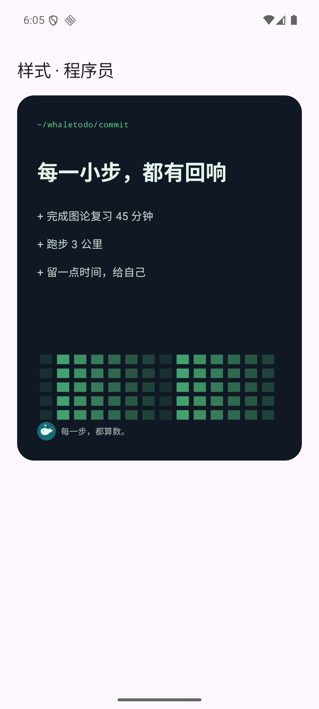
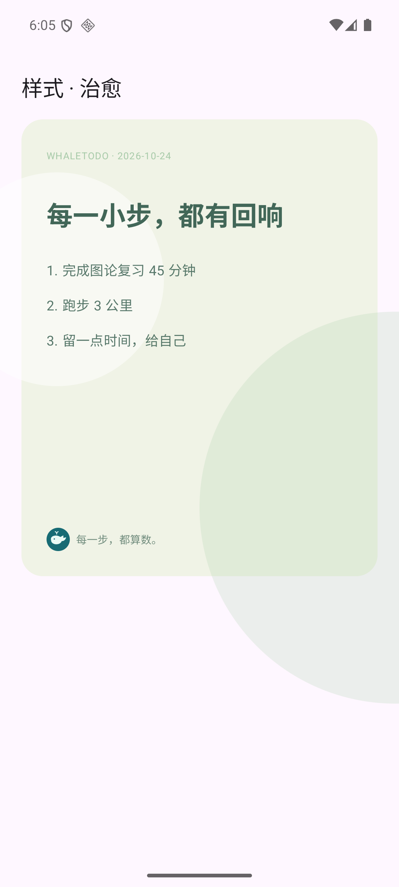
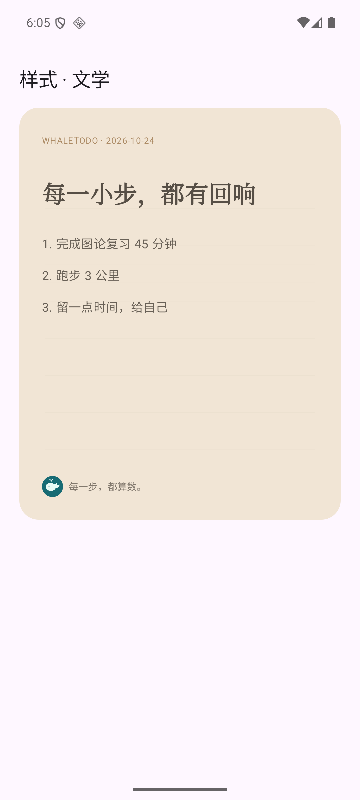
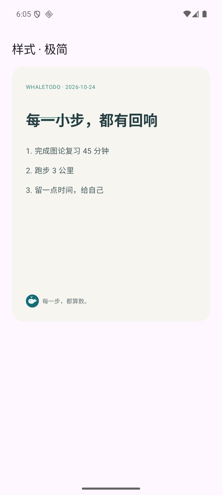
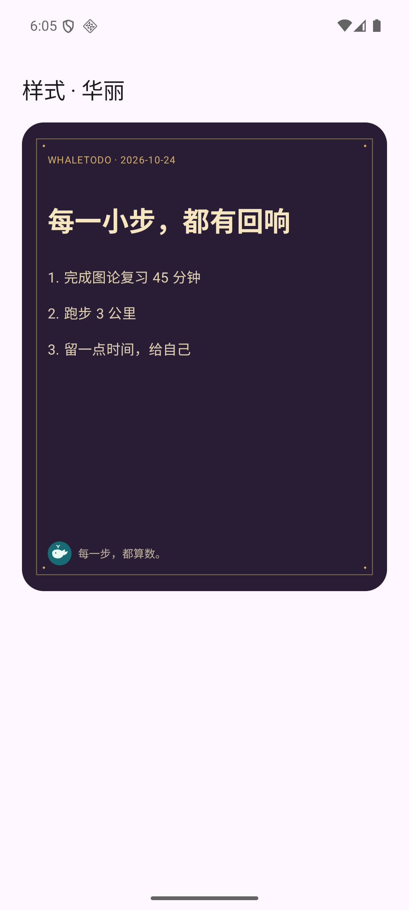
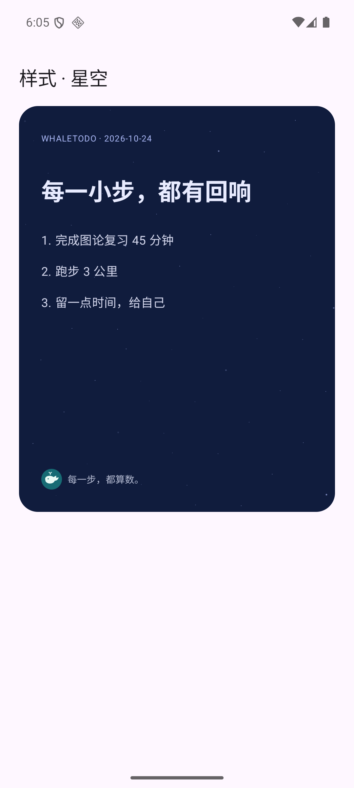
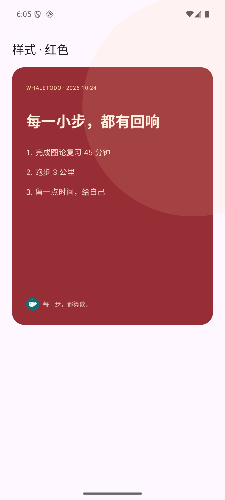
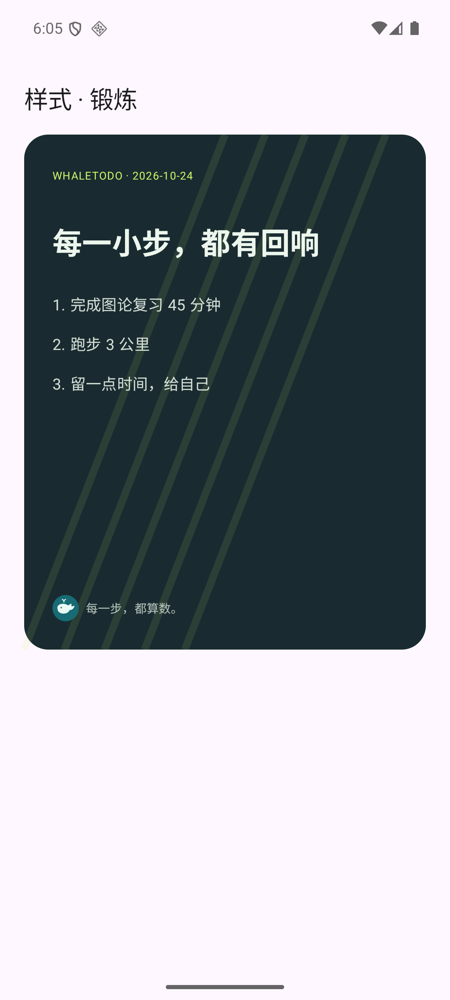

# AI助手、计量与视觉组件接入

日期：2026-10-24。版本0.4.0。Bottledkzk主责：助手UI/Agent领域规则、提示词、计量与数据库/视觉组件。本轮不接管Weiding的账户、HTTP桥接、签到/支付或社交平台调用。

## 一、交互与模式

助手使用统一输入框、模式/模型列表、只读日程开关、本次编辑授权、历史搜索/继续/归档。重建应用/新对话创建新session，不自动打开旧测试会话；会话、消息、未决请求均按ownerId隔离。仅显示Working与单调时钟耗时，消息DTO无reasoning字段。

| 模式 | 输入与提示词重点 | 输出和权限 |
| --- | --- | --- |
| 聊天 | 温和回应与一两个可执行步骤 | 最终答复；登录+积分 |
| 计划建议 | 截止、工时、可用时段、固定/完成保护 | 最多8条只读建议；不会直接改安排 |
| 周期复盘 | 已完成/未完成事实、障碍、下一步 | 简短可编辑复盘；不补造事实 |
| 日记 | 明确发生的记录，缺失情绪不推断 | 可编辑日记草稿 |
| 分享配文 | 选择的事实和八风格提示词 | 3条不超过50字的短句 |
| 调整日程 | 受限JSON提案，引用已有对象ID | VIP+安排专用模型+本次授权；仍需预览确认 |

提示词版本`agent-20261024-v1`位于`server/src/ai/policy.ts`。内部工作链路是读取副本→权限/预算检查→整理输入→生成最终内容→格式与领域校验→预览→事务提交；不要求/展示模型逐步思维链，也不将reasoning_content保存为消息。

每模式可附带相同只读日程：稳定ID、标题、分类、截止、工时、固定/完成标志、时段、时区、可用时间。默认不含备注、邮箱、账户令牌或数据库全文，最多100事项/100块，超出明确标示未附带；用户可关闭。上下文只是副本，不提供数据库写入工具。

## 二、编辑安全边界

只允许rename_task、set_category、move_block三类提案，最多12项。默认模型deepseek-default只读；安排模型code为deepseek-planner，实际模型ID只在服务端配置。服务器默认AI_EDIT_ENABLED=false，待账户权益接通评审后启用；只要启用，仍检查实际VIP有效期、允许模型及edit_consent，不能信任客户端vip标记。

移动必须保留原工时，不能动已固定/已开始/已完成块，不能超截止/可用时间或与其他块重叠。标题/分类限制，未知对象或重复字段整份拒绝。APP确认采用时比较原始日程快照，在Room同一事务内校验全部动作后写入，保留块ID；提案回执按(id,ownerId)去重。变更期间计划、时区或日期变化均需重生成，失败不部分落库。服务器只返回提案，不替客户端更改业务数据。

## 三、计数、软整理与积分

- 单次请求有稳定UUID。服务器计数按认证用户+业务日；GET /ai/usage返回requests/completed/pending、实际输入/输出/总Token及积分，k按1000格式化。
- 提交前输入数字标记≈为估算；provider usage.total_tokens是实际结算依据，不能用字符估算冒充实际Token。会话显示实际用量与调用计数，每条答复可显示实际积分回执。
- 先对完整句段做软整理，保留首尾和明确省略标记；历史最多8条且逐条限制，上下文按完整条目保留。无法安全分段的大段输入在计费前拒绝，提示分段。不给模型无限历史，也不对结构化JSON任意截字。
- 每模式给出篇幅目标，输出在完整句/小节收束。若上游仍返回length，只读内容保留完整句并标明可继续；不自动续写计费。截断JSON不变成动作。空正文/不明上游结果保持unknown，不宣称成功。
- 安全预占用UTF-8字节保守上界+输出预算；首轮技术参数每1000 Token=1积分（可配置，不是VIP套餐定稿）。预占ceil(上界/rate)，成功按ceil(实际/rate)结算，原子退差额；明确失败全释放，未知保留预算。rate随请求保存，配置变更不能改变在途结算。缓存Token仍计入Token数量，此规则不等于供应商人民币价格。
- request/source指纹绑定压缩前内容；同UUID异体409，同体返回旧结果，不重复请求/计费。
- APP未知状态保存原请求ID，显示查询结果；重开历史继续GET原ID，不自动POST新请求。查询时登录失效不能把原请求当失败退款。跨账户迟到结果丢弃。网络桥接需遵守下面的明确结果类型。

## 四、给Weiding的接口契约（账户/网络仍由你实现）

`AgentBridgeHub.bridge`由应用可信初始化接入`AgentBridge`；本仓库默认桥接为访客/未连接，没有供应商直连、API Key导入或演示账号后门。androidTest中的FixtureBridge仅是测试APK。

- access StateFlow：服务端认证userId、有效VIP、可用积分、连接状态和允许的editModels；不能靠本地开关把访客变会员。models含code/title/canEdit/requiresVip，读取GET /ai/models。
- reply(AssistantRequest)：只POST自有TLS服务器。ownerId是本地归属绑定，不能序列化成服务端信任的user_id；桥接开始时核对并冻结对应账号的Bearer令牌，换号取消/拒绝发送旧上下文。
- wire：client_request_id、mode、model_code、prompt、context、history[{role,content}]、edit_consent、share_style。history只含user/assistant，不能发送额外system提示词。分享风格code为minimal/github/healing/literary/ornate/starry/red/fitness。
- 成功data映射text、usage_tokens/input_tokens/output_tokens、points_charged、continuation及proposal.changes；只显示最终text。动作转换成core的强类型AgentChange。所有id/时刻仍在采用时本地校验。
- 202、超时/断流或status unknown/running/reserved→AgentPendingException(原ID)，query(id)只调用GET /ai/requests/{id}。最终失败/明确拒绝→AgentServiceException(definitelyRejected=true)。不能把未知当失败后自动重发。
- 401→GateReason.LOGIN；402→POINTS；403 details.reason=VIP_REQUIRED/MODEL_NOT_ALLOWED/CONSENT_REQUIRED→VIP/MODEL/CONSENT；网络不可达→CONNECTION/未决状态按是否已发送决定。AccessDialog提供账户/会员/积分/授权导航回调，UI不实现支付。
- 每次调用/查询后刷新账户钱包与当日usage；不得依据客户端字符串直接设置积分。

建议账户权限矩阵：

| 身份 | 助手 | 分享 |
| --- | --- | --- |
| 未登录 | 禁止；本地记录/自动安排仍可用 | 禁止导出/发送，可预览样式 |
| 已登录普通用户 | 积分可用时聊天、只读建议/复盘/日记/配文；不能直接调整日程 | 默认极简模板；高级模板需VIP或服务器积分试用 |
| 有效VIP | 仍按实际Token消耗积分；指定安排模型+本次授权才生成编辑提案 | 高级模板可用；具体积分奖励/权益后续确认 |

authorizeTemplateTrial(template)必须由你接服务端，按认证用户、模板、幂等键、有效期/次数原子核验与扣分后才返回许可。不要以本地布尔值直接扣积分或冒充支付。建议返回单次试用回执，绑定用户/模板/内容与过期时间；最终方案由账户/分享模块PR共同确认。

## 五、分享视觉与事项分类

ShareCardPreview提供8种原生布局：程序员（代码/活动矩阵视觉）、治愈、文学、极简、华丽、星空、红色、锻炼。默认极简，高级样式显示VIP。矩阵/星点是装饰，不能当真实完成统计。配文风格与同一code对齐。

WhaleAvatar复用项目自有矢量鲸鱼。事项类型为none/study/exercise/entertainment/work/social/travel/rest，编辑器可选，卡片用标签+符号+颜色共同呈现，旧数据默认none。

本轮只交付预览/视觉组件、文字分享门禁、模板试用桥接回调；生成图片、相册/相机、保存图片与QQ/微信等社交调用仍由Weiding实现。调用分享成功不等于发布成功。当前按钮明确为分享文字，不冒充已生成图片。

## 六、迁移、测试与部署边界

Room v2→v3增加category、账户分区的会话/消息、未决查询元数据和一次性提案回执；旧五表内容应按升级前列集校验。迁移测试资源依赖kspVerificationKotlin，避免拿旧schema校验新APK。测试只跑verification包，正式包用保留数据覆盖升级。

PG第五个迁移增加分类和AI计量/提案字段，AI角色多授予只读权益所需列。本轮仅在whaletodo_verify迁移/联调，新迁移/计费/模型开关未切现网，待交叉评审及账户桥接准备后统一部署。应用正式桥接仍由队友接入，不能把UI测试适配器或隔离商业模型验证写成APP线上闭环。

真实模型只发2条合成请求：chat 220 Token，edit 381 Token，均成功；安排模型返回1项提案，原任务未被服务端改动，测试账户已清除。其他并发/失败/权限测试使用明确模拟上游。供应商密钥留在服务器0600文件，本地联调脚本/临时产物在仓库外。

验证与已知限制以PR和个人test/receipt为准。原始失败日志保留：首次Compose语法/控件定位，以及schema资源顺序和旧分享流程断言；修复后针对验证，不隐藏失败历史。截图位于assets/agent-v04，全部是合成数据。

## 七、验收摘要与预览

- core 33项、server 75项、独立PG 14项通过；设备26个唯一用例分批通过（原16＋新10）。完整24轮首次有schema资源落后及旧分享断言失败，修复后针对复测；最后换账户/未决查询及手动安排分别通过，不冒充一轮全绿。
- 正式调试包0.4.0/Room3保留数据升级：原5事务、2安排、1打卡、1日期WorkTime的旧列哈希相同，新增分类默认none、聊天表为空。正式桥接仍为访客/未连接；本地验证数据/密钥未进入正式包。
- 新提示词、输入软整理、输出收束和实际用量单测通过。真实商业模型2条合成调用与UI测试适配器分别记证据。

| 程序员 | 治愈 | 文学 | 极简 |
| --- | --- | --- | --- |
|  |  |  |  |

| 华丽 | 星空 | 红色 | 锻炼 |
| --- | --- | --- | --- |
|  |  |  |  |

所有截图均为合成示例，不含私人日程；完整图可单击查看。
