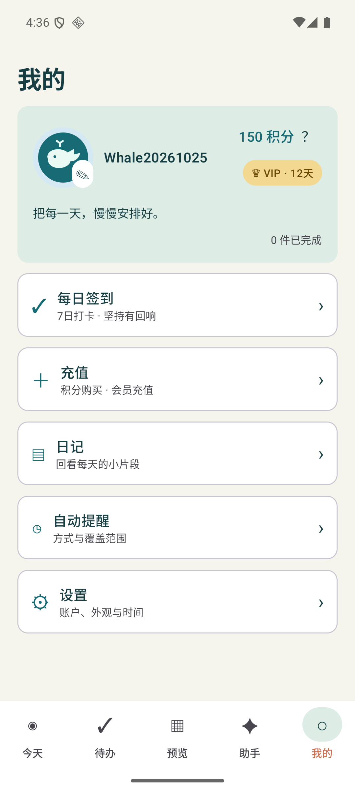
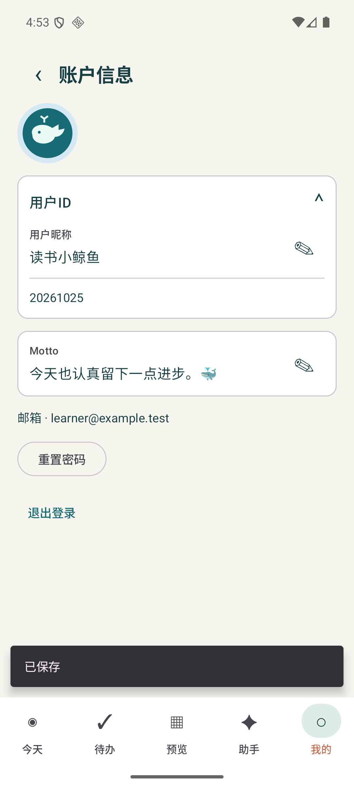
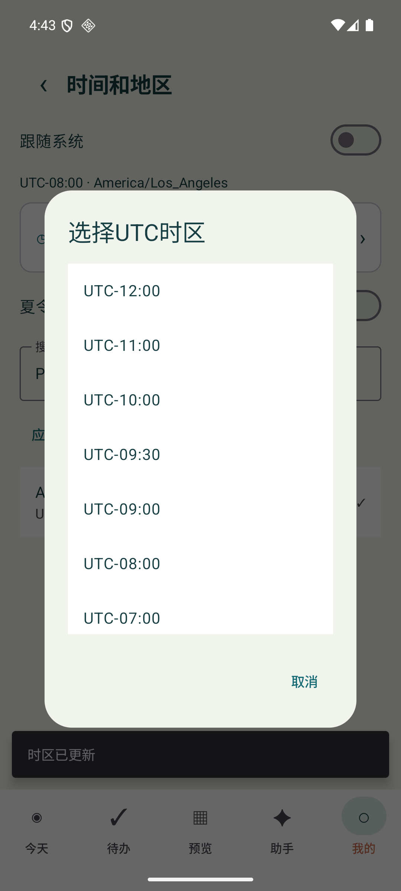

# 个人资料与时区交互优化

日期：2026-10-25；应用0.5.1/code8，Room仍为4。范围为个人资料、导航和时区的UI/本地行为；不实现账户HTTP、媒体权限、收费或提醒硬件链路。

## 用户可见变化

- 预览页移除统计解释句；积分获取弹窗移除裸Issues网址和奖励注释，保留“提出建议”入口；Working时间入口移除副标题。
- 我的卡片：头像和昵称在左，积分和问号在右上，VIP徽章在积分下。Motto在身份区域下方；未登录显示本机访客和灰色0积分，非VIP徽章灰色且可打开会员充值。有效VIP点亮；仅真实提供到期时间时展示剩余天数，不编造期限。
- 离开我的标签或再次点击我的，设置及子页面返回位置重置为我的首页；需要重新从设置进入。
- 账户页“用户ID”可展开，昵称可内联编辑，编辑按钮切换为√和关闭，ID只读；Motto独立编辑。昵称最多16单位（Han汉字2、其他Unicode码点1），Motto最多30个Unicode码点，粘贴会截到完整码点边界，无规则注释或计数字样。
- 注册新增公开昵称，预填Whale前缀；用户可改，邮箱和密码仍是认证信息，昵称不参与登录凭证、授权或幂等身份。

## 公开资料与网络交接

`ProfileDetails`末尾增加`motto`与可空`vipExpiresAt`，保留既有位置参数兼容。昵称无有效值时由`publicId`的短数字后缀生成Whale默认名；公开ID本身不可编辑，不以昵称派生认证身份。

`ProfileBridge.register(email, code, password, nickname: String? = null)`新增可空公开昵称参数。注册页在账号尚未创建时显示草拟Whale昵称，未修改则传null，由服务端在分配真实publicId后生成正式默认昵称；修改过则传校验后的昵称。不要把草拟后缀写入user_id或当作已分配账号ID。Weiding接入时将公开昵称映射到display_name，保留邮箱/OTP/密码和既有认证流程；本PR没有伪造注册成功或增加服务端路由。

账户页编辑当前保存为owner分区的`profile.nickname`/`profile.motto`本地偏好，冷启动保留，换号不串值；可由真实ProfileDetails提供初始值。本轮不宣称云端公开资料或跨设备同步已接通，也不扩大#12同步白名单。后续公开资料HTTP/缓存协调由账户网络层统一接入，不直接修改username、email、user_id或VIP权限。

## 时区与日程选择

跟随系统时隐藏自定义搜索、UTC选择和夏令时设置。自定义保留IANA地区搜索/固定偏移输入，支持PDT/PST定位洛杉矶；另有UTC偏移弹窗，包括半小时和45分钟区域。地区在当前年度有夏令时才显示开关，关闭时使用该地区标准偏移；固定UTC偏移无夏令时，跟随系统交给系统规则。

每次时区/夏令时/跟随方式更改先请求确认，取消不落库：

| 选择 | 处理 |
| --- | --- |
| 不调整日程（默认） | 仅更改显示与后续规划时区，现有事件epoch毫秒完全不变。 |
| 同步日程时间 | 保留原来当地钟点，移动未完成事项的未来截止和未开始、未完成时间块；例如UTC09:00改上海后仍为上海09:00。时间块时长、ID、锁定标记保留。 |

已完成事务/历史安排/打卡时间/创建时间均不移动；每日与星期Working仍按当地钟点使用。转换在一个Room事务中写入日程与时区，检查时区未被另一操作更改、DST不存在时刻、移动到过去、冲突和截止约束；失败整笔回滚。系统时区变化只影响显示，不自动批量改写日程。应用设置不改服务端BUSINESS_TIMEZONE及签到/积分业务日。新设置使用现有`ui_preferences`的`time.zone`/`time.dst`，不新增表或迁移。

## 验证与交付

47项core规则检查、官方Debug/verification构建通过；12个不同设备用例分批通过，不是单轮12/12：首轮7/9，目标复验5/5，保存保护后3/4及最终原用例1/1；失败记录保留。最后的长度验收核对保存后的Room值与只读显示，而非不一致的输入框无障碍缓存。所有身份、邮箱、积分和VIP交互截图使用独立verification包合成桥接，真实网络/邮箱/VIP服务不计为已联调；不发布正式APP数据或截图。正式包升级前保留私有备份，并检查旧表行哈希。

正式0.5.0→0.5.1覆盖升级完成，Room4→4；11张业务表与android_metadata全部行哈希保持一致。APK SHA256：`1a612de58f4e8beafce0f8fdbc4d37a9bffff48e1c71a90d3fbcb36a3aab3f96`。实际账户HTTP、云端公开资料、真机仍未联调。

以下均为verification合成资料截图：

