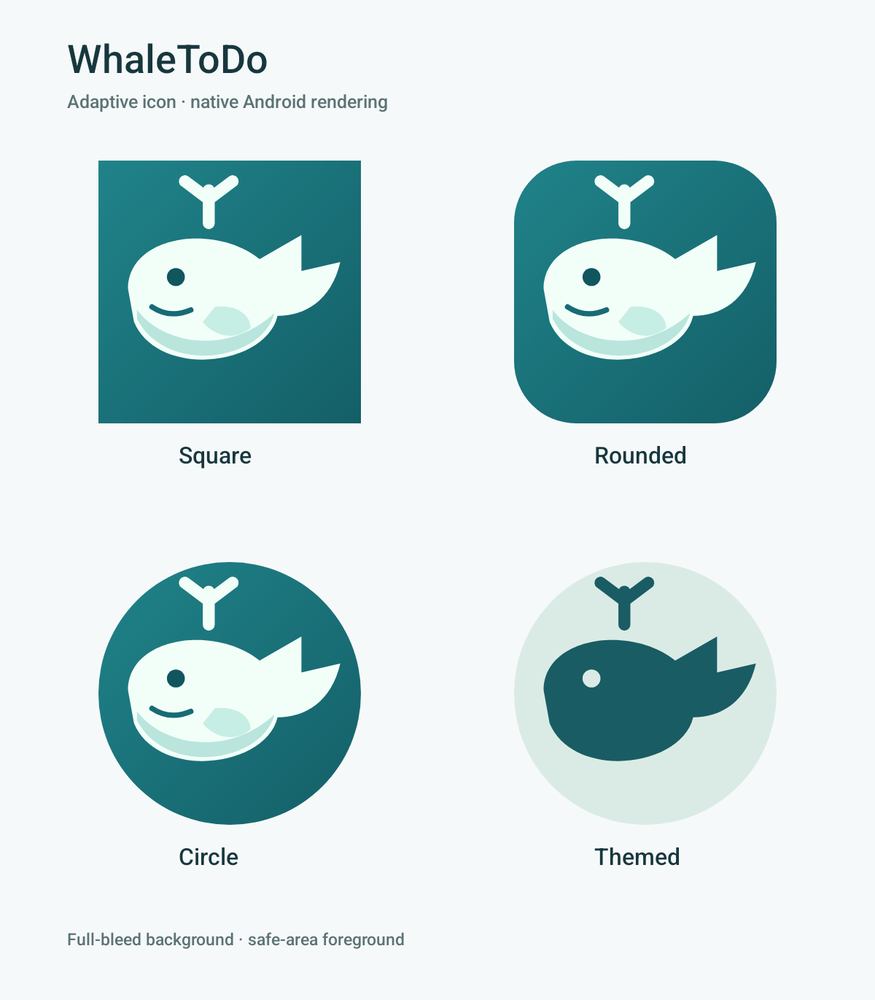
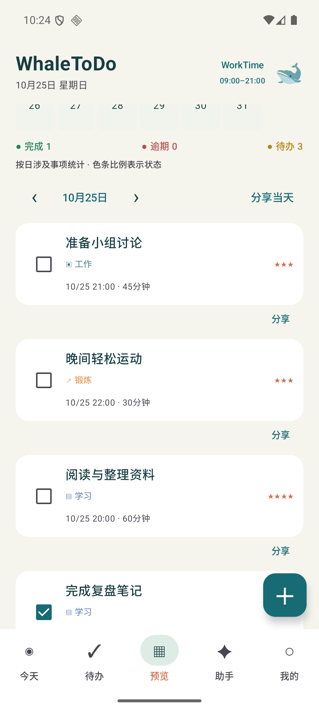

# 0.4.1 图标与列表细节调整

日期：2026-10-25。基于已合并的#5（ccf3890），只处理本轮两项外观需求。

## 图标

启动图标采用108dp独立矢量前景和满幅渐变背景；鲸鱼主体缩放到66dp安全区域，随启动器裁为方形、圆角或圆形。Manifest配置icon/roundIcon，API33增加独立monochrome图层，支持主题着色。应用内默认头像沿用现有资源。

依据：[Android自适应图标规范](https://developer.android.com/develop/ui/compose/system/icon_design_adaptive)。Android原生图层裁切预览和当前模拟器启动器图标如下；形状由启动器决定，不声称所有厂商ROM已实测。

[当前启动器实际图标](assets/launcher-v041/launcher-actual.png)

## 待办和活动预览

共享AgendaTask不再额外输出“开始日期时间—结束日期时间 · 自动/手动”行，待办日程与活动预览的事项卡片直接呈现标题、类别、截止和工时。日期筛选、排序、完成与分享入口可继续使用。

| 待办日程 | 预览列表 |
| --- | --- |
|  |  |

截图为verification独立包的合成数据。

## 验证与交付

- 正式debug与普通verification构建通过，既有33项core规则由Gradle缓存校验；现有“预览三状态/完成打卡”设备回归1项通过。
- 原生图标预览4形态与实际启动器显示已检查；实际操作待办日程和活动预览，界面树确认额外区间行消失。
- 正式应用保留数据覆盖升级为0.4.1（versionCode 5，Room仍v3），8张业务表与Android元数据升级前后哈希一致；保留5事项、2安排、1打卡和2条每日时段。
- 正式APK已检查不含私有预览Activity和供应商Key；没有新增数据库迁移或账户/网络功能。
- 本地APK：build/output/app/outputs/apk/debug/app-debug.apk；SHA256为bbc2d4d693673b3bd37477e89c29ba25c592c1d0c9604fced6a3a529699d63d0。此为本机验证调试包，不是公开Release下载声明。

私有工具首次编译/启动适配后已复测通过，原始日志保留在个人test目录。不同厂商与真机仍按后续双方手机验收；本轮不变更服务器部署。
