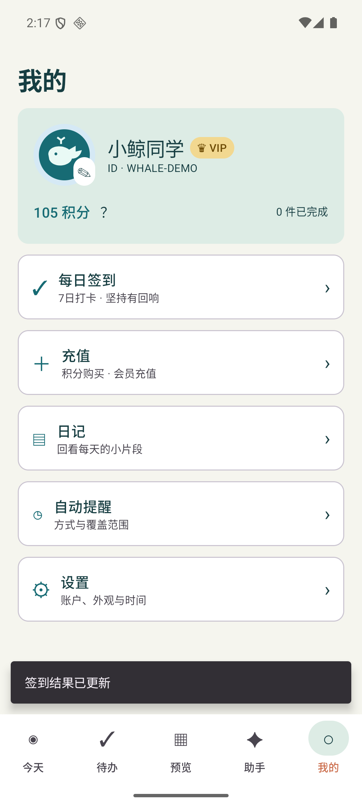
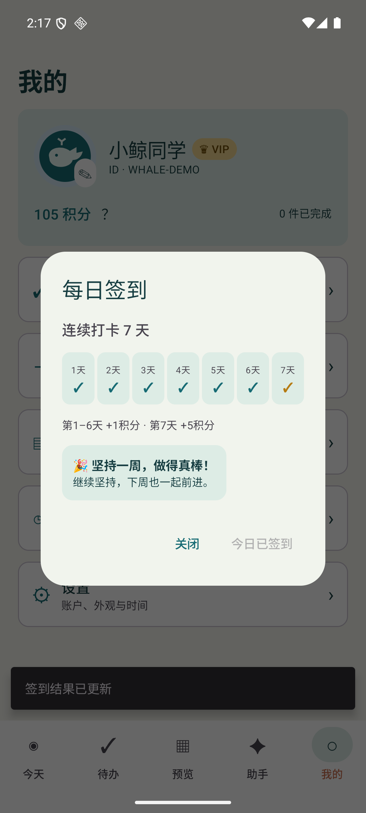
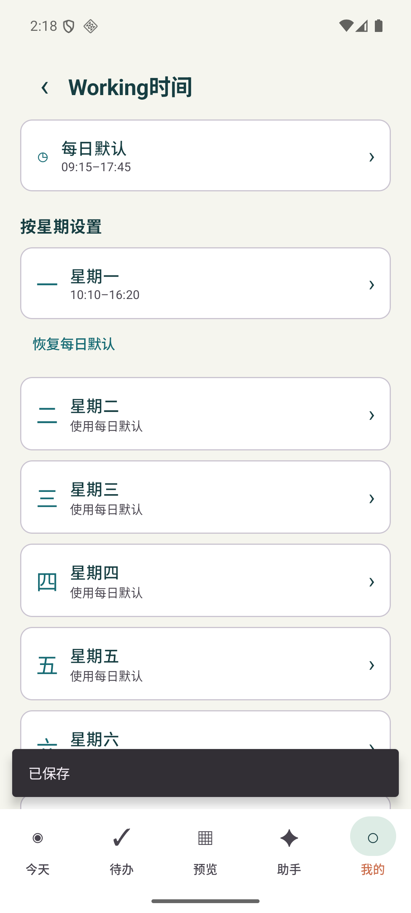
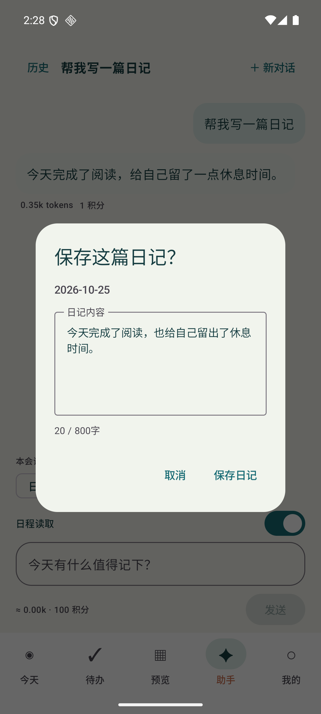

# 我的、设置、提醒与日记接入

版本：0.5.0 / code7，基于PR11的助手确认流程。此PR按项目发起人本轮要求实现前端与本地数据，不代写Weiding的网络、媒体权限、邮件、支付或系统提醒。

## 交付范围

| 入口 | 本次实现 | 后续接口归属 |
| --- | --- | --- |
| 头像 | 内置鲸鱼配色编辑、头像预览、相册/拍摄入口；账户分区保存本地选择 | Weiding负责选图/拍摄、权限、裁剪/缓存及安全URI授权 |
| 每日签到 | 单一弹窗、7天打卡条、连续天数、第7天祝贺、未登录转登录；展示1/1/1/1/1/1/5积分 | Weiding提供认证签到及持久历史、业务日期与权威余额，前端不自增真实钱包 |
| 账户栏 | 头像、用户ID、VIP勋章、积分；访客0积分灰色 | 以同一AgentAccess及匹配userId的ProfileDetails为准，不复用其他账号资料 |
| 积分帮助 | 去签到、积分充值、VIP充值、GitHub Issues；替换弹窗跳转 | 建议奖励待服务审核，不因打开Issues发积分 |
| 充值 | 积分购买/会员充值切换、套餐选择及登录提醒 | 仅UI，价格和权益待公布，不下单、不收款、不解锁权益 |
| 设置 | 单独页面和左上角返回；账户信息/重置密码、外观、Working、时间地区、版本及GitHub | 账户变更和密码重置链路由Weiding完成 |
| 注册/登录 | 邮箱、密码、邮箱验证码及重发等待界面；密码仅短暂留在表单内存，不保存或记录 | Weiding接认证与邮件验证码，未连接不显示发送/登录成功 |
| 自动提醒 | 开关、消息/闹钟/两者、全部或最低星级范围，持久偏好 | Weiding获取权限、注册/取消提醒、重启恢复和真机验证 |
| 单事务通知 | 整理待办中开关、方式、开始/结束/两者，和事务同一事务保存 | 仅偏好UI，不调用AlarmManager/NotificationManager；不能视作提醒已生效 |
| 日记 | 日期选择、本地编辑保存、800字、二次确认删除；AI生成预览可编辑、覆盖已有内容再确认 | 日记本地持久化已实现；线上模型/账户与后续同步待网络接入 |

## 单弹窗与导航

ProfileController持有唯一MyDialog枚举。积分帮助到签到、充值到登录、登录到注册、日记到日期/删除/覆盖确认均替换原对话框，不叠加。设置及其子页面使用MyPageRoute，返回逐级回到设置/我的；保留原外观主题的即时切换。模型日记在其他弹窗存在时排队，关闭后才展示，不打断当前表单。

## 本地设置和排程

Room从3升4，仅新增三张表，既有八张业务表不改列、不删除：
- ui_preferences(ownerId,key,value)：device分区保存working.default、working.1至7及time.zone；账户分区保存头像与提醒偏好。
- task_reminders(ownerId,taskId,enabled,method,timing)：用户最终选择为该事务显式覆盖；新打开编辑器没有覆盖时按自动提醒开关及最低星级初始化。
- diaries(ownerId,date,content,updatedAt,sourceMessageId)：单账号单日期一篇日记，含更新版本检查。

Working优先级：具体日期覆盖 > 星期覆盖 > 每日默认 > 原settings小时配置。默认/星期支持分钟精度，修改设置进入后续自动排程，今日独立WorkTime仍保留。应用时区支持系统、IANA名称及自定义固定偏移；切换只改变本地显示、日期归属和以后排程的墙钟解释，既有epoch时间不重写。设置变化使旧排程/Agent快照失效；夏令时处理沿用既有规则。

这些新增表暂不在PR12冻结的五种同步对象中，不要求Weiding在本次同步PR扩展白名单，不把本地持久化写成云端已同步。后续同步日记、提醒、UI偏好应另行评审字段、账号清理和隐私范围。

## 网络与系统能力接点

新增ProfileBridge接口，只定义可替换UI传输接点：details StateFlow、login/register/requestCode/resetPassword/signOut/signIn/pickAvatar。正式默认实现全部未连接；不内置账号、验证码、模型Key或钱包。AgentAccess仍是同一认证userId、VIP、可用积分来源。ProfileDetails仅在userId一致时展示，包含昵称、公开ID、邮箱、已授权头像content URI、签到日期与服务端业务日期。业务日期独立于用户手动时区，避免切时区重复签到。

pickAvatar由Weiding返回已授权可读的content URI；UI仅做有尺寸上限的缩略图解码，不主动申请相机/相册权限，不加载任意网络图片。默认内置头像配色可离线编辑。

**需要Weiding对齐：当前主分支签到服务仍是既有每日奖励规则，本需求改为连续1–6天各1积分、第7天5积分。此PR只展示新规则，未改其服务业务；真实奖励必须在后续服务PR中对齐，服务端仍负责重复请求、连续天数、业务日期、钱包与账本。邮箱验证码接口和充值同样尚未实现，UI不会模拟真实发送/收款。**

## 日记安全边界

服务端diary模式使用内部JSON {"diary":"正文"}，只接受单一正文键、最多800个Unicode字符；拒绝任务汇报、生成说明、模型身份等脚手架，不能输出保存授权。网关剥离JSON后仍返回既有text协议，实际Token照实结算；格式错误或截断提示不可保存，不把供应商已经消耗的Token当作未调用。

客户端再次过滤模型正文。草稿不会直接落库；显示“保存这篇日记？”可修改，超过800字不能保存。已存在当日日记时替换需再确认，保存/删除都校验原行版本，防止过时预览覆盖新内容。访客手写日记在guest分区；登录后不自动合并其他分区。正文、密码、验证码和正式截图不进入仓库或PR。

## 验证

首轮官方Debug构建、42项core规则、134项服务端测试和strict类型检查通过。Room4迁移、日记账号隔离/上限/过期写入、提醒原子性、时区不重写时间等设备数据测试已通过；18个不同设备用例分批通过（新界面10、数据/迁移3、既有回归5），非单轮全绿，失败日志保留。早期失败涉及新Activity焦点、输入就绪和滚动目标；修正测试等待/定位后针对性复测通过。真实邮件、支付、通知/闹钟、相册/相机权限、账户→AI线上闭环不计作本次实测成功。

正式应用保留数据覆盖升级0.5.0/code7及Room3→4成功；8个原业务表与元数据的完整行哈希一致，保留5事务/2安排/1打卡/2每日时段，新表初始为空。APK SHA256：e1eaa50abf515fba07a7f0e6d2f1097e8ece28c47fd9611ea7765f29589d2843。正式APK排除测试桥接、合成账号、QA Activity和供应商Key。CI结果见PR检查；未进行服务器生产部署或真实模型调用。

提醒时间语义供后续接入：有安排块时按块开始/结束选择；尚无安排块的事务仅保留偏好，不猜测执行时刻。

下面仅为独立verification包的合成数据截图，非真实账户、签到、邮件或付款回执：

最后补充头像缓存绑定账号/URI，头像和账号切换2项复测通过；最终同版本覆盖升级保留全部11业务表与元数据。
