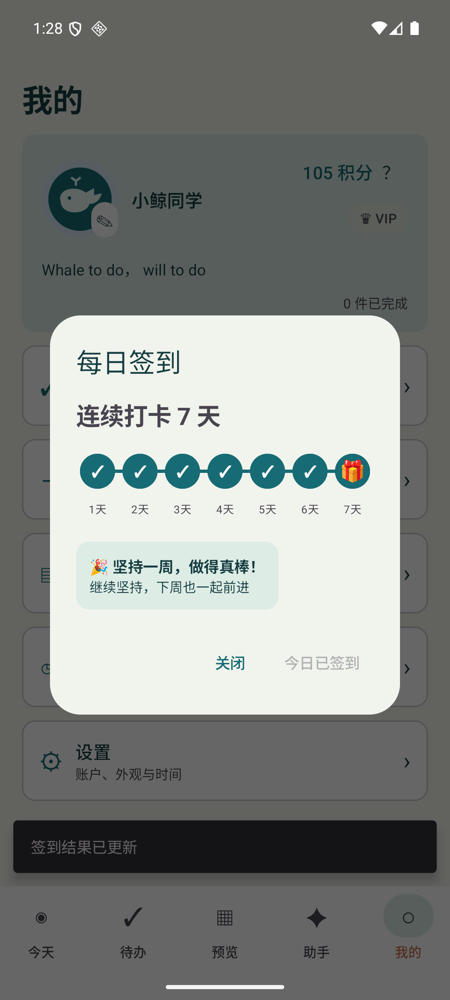
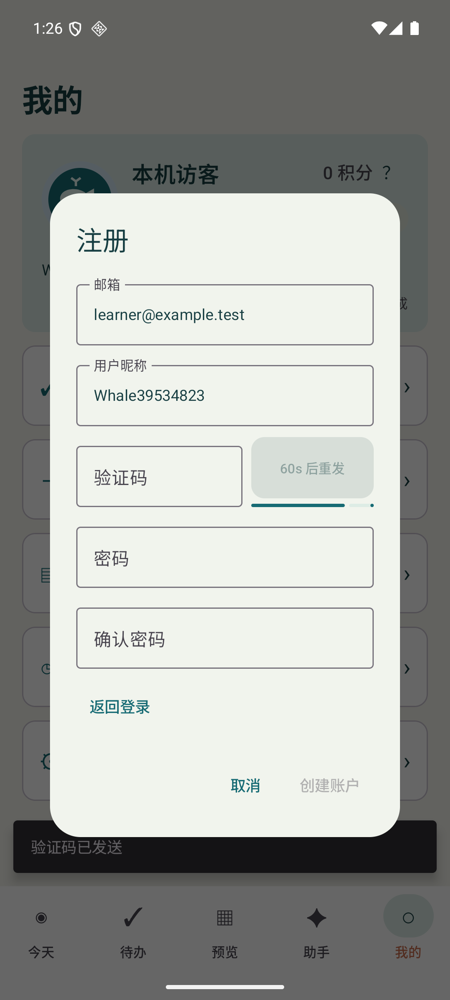

# 界面精简与签到验收

内置界面文案去除中文句号，网页删除指定的账户、安装和手动校验说明，首页增加 `Whale to do, well to do`。版本、下载按钮、备用 Release 入口仍引用已公开的 0.5.2-preview.1 附件；后台发行校验、签名和附件保留。用户输入的任务、日记、自定义 Motto 和 AI 正文不做标点替换。

每日签到改为相连的七节点进度条，第七天使用礼物图标，移除底部奖励注释。原签到日期、积分和重复签到规则保持不变。默认 Motto 为 `Whale to do， will to do`，空白资料与访客使用默认值，已有自定义内容保留。

注册和重置密码沿用同一验证码组件。发送成功后至少等待 60 秒，遵守服务端更长的等待值（现有上限 300 秒），显示灰色按钮、剩余秒数和线性进度动画；发送失败可重试。同一邮箱和用途关闭重开后仍计时，控制器也阻止等待期重复请求。计时使用单调时钟，不受系统时间调整影响。

## 验证

- core 61、network 47、app 71 项单元检查通过
- verification APK 与测试 APK 构建通过
- API 36 模拟器显式执行 `ProfileCleanUiTest` 三项通过，使用合成账户传输，没有发送真实邮件、调用模型或清空应用数据
- 注册场景实际等待完整 60 秒后恢复发送，期间按钮禁用、秒数递减，关闭重开不重置等待，结束后可再次发送
- 重置密码发送失败后可重试，成功返回 120 秒时保持更长等待
- 连续第六天到第七天进度更新，余额从合成 100 到 105，重复点击不再签到；默认 Motto 可见，自定义句号保留
- 网页在桌面和 390px 手机宽度检查，无横向溢出、图片加载成功，指定说明和句号不再显示，用户输入的句号保留

本次界面验证不代表真实邮箱、账户或模型端到端验收。既有 0.5.3 候选发行附件不覆盖；APP 界面修改随本 PR 交叉评审后纳入后续发行。

同时采纳 PR #46 的非阻塞建议：构建元数据的邮件状态改为 `not_verified_by_build`，文档明确 true/false/null 的验收含义，避免构建结果暗示真实邮件已验证。
