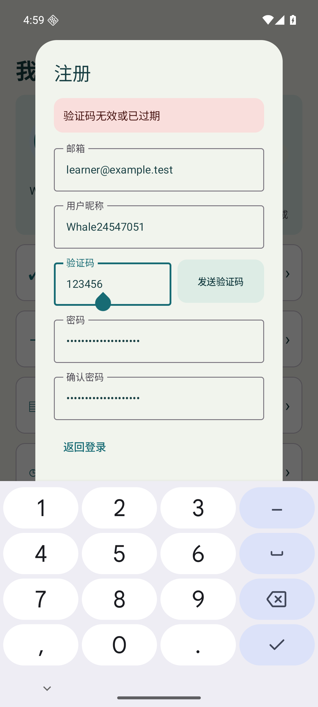
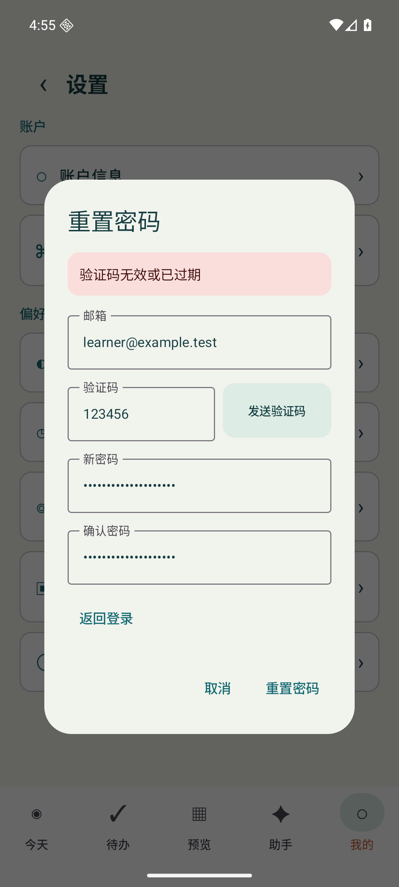

# 账户错误提示验收

注册、重置密码及登录的错误提示固定在表单顶部，不再滚到内容末尾才可见；提示以错误容器色和无障碍通知呈现。对话框后方的页面不重复展示同一错误。保留邮箱、验证码、密码和昵称，修改字段后清除旧错误，不自动提交或重试。

本地校验区分邮箱、密码长度和验证码位数，确认密码不一致时显示对应提示。服务端验证码无效或过期的原有中文提示继续传到 UI；断网后保持输入，可手动重试，不显示虚假的发送成功，也不开始成功冷却。

## 验证与边界

- core 61、network 47、app 73，共181项单元检查通过；新增桥接测试用本地合成 HTTP 验证注册/找回错误码及登录/注册/找回断网映射
- verification与测试APK构建通过
- API36临时验证环境的6个不同界面场景全部通过：首轮5/6，剩余用例仅因对话框动画前立即找输入框失败，测试加入等待后定向1/1通过；不冒称单轮6/6
- 6个场景包括注册错码+键盘、找回错码+密码不一致、断网发码/登录+重试、60秒完整等待+重开、120秒合成等待+失败重试、第七天签到与Motto保留
- 错码和断网均为合成传输，未发送真实邮箱验证码、未修改真实密码、未将合成测试当作生产账号验收
- 原模拟器所在调试端口被Windows系统保留范围覆盖；使用独立临时AVD及空闲端口完成验证，没有清空原模拟器或触碰真机

