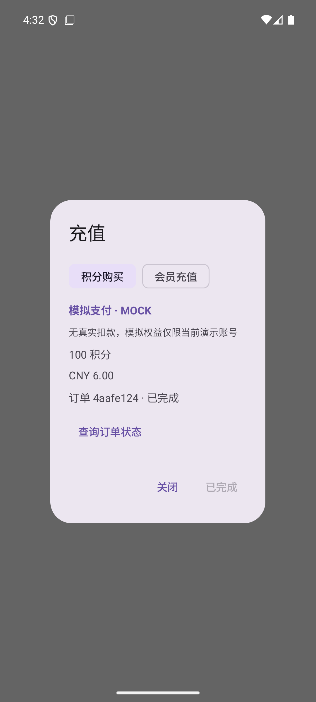
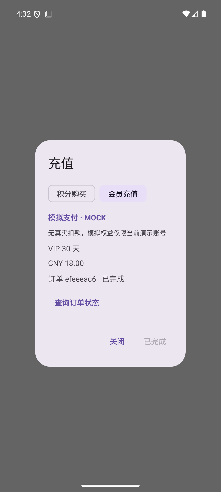

# 银联沙箱核对与 MOCK 演示支付

2026-10-30。按项目发起人本轮调整，支付系统由 Bottledkzk 负责，Weiding 交叉评审账户和账本接入。账户同步文案另在 PR #53 更新。

## 银联实际测试与结论

本轮采用官方「线上收银台（通用版）」Android 3.5.19 SDK，独立探针包使用 targetSdk 36、测试模式 `01`。商户私钥、测试证书、应用网关认证信息、个人测试商户号均不进入仓库或 APK。

| 层次 | 实际结果 |
| --- | --- |
| 官方开发包公共示例商户签名下单 | cup.com.cn 与 95516.com 两个测试网关均 HTTP 200、respCode 00，获得 TN |
| 响应验证 | RSA-SHA256 签名、官方测试根/中级证书链及有效期校验通过；HTTPS 校验保持开启 |
| Android 16 / API36 x86_64 模拟器 | 原生库加载、SDK 调用返回 0；WebView TLS 连接中断，未完成支付 |
| 小米 14 Pro / Android 16 / arm64 | 独立包安装和拉起云闪付通过，网络调整后的新订单仍报 `6670008 / WL04201`；查单未确认成功 |
| 登录官方平台后的专属测试商户 | 平台证书与 SDK 测试证书逐字节一致，下单返回 `11 / 9100004`；专属商户配置/证书关联的具体原因未确认 |

随后查到[官方 FAQ 564](https://open.unionpay.com/tjweb/support/faq/mchlist?id=564)：不提供测试云闪付 App，也不能用正式云闪付 App 测试沙箱。这直接限制当前「拉起云闪付完成沙箱付款」路径。API 认证账号页的 OAuth/AppID/AppSecret 不能替代全渠道 5.1 商户证书认证，也不能解除此客户端测试限制；未修改用户密钥或 IP 白名单。

因此按项目发起人要求，本轮仅落地 **MOCK 演示支付**。没有真实付款、银行卡绑定或资金结算，不把下单成功、TN 或 SDK 返回 0 写成支付成功。

其他官方依据：[产品及 SDK](https://open.unionpay.com/tjweb/acproduct/list?apiSvcId=3021&index=4)、[本次开发包](https://open.unionpay.com/upload/tj/file/1785229100413076849.zip)、[验签错误排查 FAQ 474](https://open.unionpay.com/tjweb/support/faq/mchlist?id=474)。开发包 SHA256：`29070bf91dd0022ee71ec772bf1ebe5b5a6cf0febe9528779ef40e8854f1c1f0`。二维码仿真和其他支付服务的测试卡不作为本产品 App 支付通过的证据。

## 实现与环境限制

新增独立 `paymentDemo` 调试构建，包名 `io.whaletodo.app.paymentdemo`，默认仅连接本机演示服务 `http://10.0.2.2:18080/api/v1`。它可与正式、预览及 verification 包并存。

正常应用在支付关闭时显示「充值尚未开放」。只有服务端同时声明 mock provider 和 mock checkout 能力时，才显示「模拟支付 · MOCK」及无真实扣款说明。商品名称、金额、积分和 VIP 天数全部读取服务端目录；目录沿用原有演示商品，不代表公开价格。

接口：

- `GET /api/v1/products`：新增 `payment_provider`、`mock_checkout` 能力字段
- `POST /api/v1/orders`：客户端只发送 product_id 和持久化 Idempotency-Key
- `GET /api/v1/orders/:id`：按登录账户查询原订单
- `POST /api/v1/orders/:id/mock-pay`：显式模拟确认，只在 test/demo 且 provider=mock 时注册；拒绝客户端传金额或权益，服务端从不可变订单快照发放权益

模拟确认使用稳定的订单事件编号，复用既有支付事务、账本和 VIP 叠加逻辑。并发确认或响应丢失后的重放不重复发放。仅服务端确认 PAID 后刷新余额/VIP，不乐观加分。生产配置仍为 `PAYMENT_PROVIDER=disabled`，生产启用 mock 会拒绝启动，无新数据库迁移、生产配置或余额变更。

## 恢复与隔离

客户端按 API 基址和账户分别保存原商品、幂等键、创建时间及订单编号。下单前必须持久保存回执；写盘失败不发下单请求。未知下单只能由用户选择「恢复下单」重放原键，打开页面不会自动付款。有订单编号时只查原订单；超过 23 小时的无编号请求停止重建，交由维护者核对，避免超过服务端回执有效期后生成另一订单。

关窗保留未完成订单，成功刷新权益后才清理回执。HTTP 写入及余额/VIP 查询绑定原会话，等待 IO 或支付在途换号时不使用新账号令牌，也不把旧账号权益写入新账号。助手会话、日程云备份及个人资料同步范围不增加支付恢复文件。

## 本地运行

Node 24，先安装现有 server 依赖。单独终端运行演示服务；密码和模拟配置值由开发者临时设置在该进程环境，不提交到仓库。使用没有生产配置的工作目录，清除继承的 SMTP_*、DATABASE_URL、DEMO_EMAIL_OUTBOX 等变量，避免连接生产或发邮件。

```powershell
$env:NODE_ENV='demo'
$env:PAYMENT_PROVIDER='mock'
$env:HOST='127.0.0.1'
$env:PORT='18080'
$env:DEMO_EMAIL='paymentdemo@example.invalid'
$env:DEMO_PASSWORD='Mock-'+[guid]::NewGuid().ToString('N')
$env:MOCK_WEBHOOK_TOKEN=[guid]::NewGuid().ToString('N')
node src/main.ts
```

构建与检查（使用项目 Android 进程环境）：

```powershell
.\gradlew.bat :network:test :app:testVerificationUnitTest
.\gradlew.bat :app:assemblePaymentDemo :app:assemblePaymentDemoAndroidTest -PtestBuildType=paymentDemo
```

只向授权项目模拟器安装 paymentDemo 及其测试 APK。`MockPaymentFlowTest` 运行前强制检查包名和本地 API 基址，测试 email/password 从 instrumentation 参数 `payment_email` / `payment_password` 传入，不写入测试代码。需先启动上述仅内存演示服务。

验证包含真实本地 HTTP：登录演示账号 → 获取目录 → 创建积分订单 → 关窗/重开恢复原编号 → 明确确认模拟支付 → 刷新余额 → VIP 订单 → 刷新到期时间；不调用模型、SMTP 或生产服务。恢复异常、并发发放、越权与生产门禁另有主机回归。





本机最终验证：服务端 294 通过、1 项 POSIX 权限检查在 Windows 跳过，类型检查通过；network 54/54、app 91/91；API36 模拟器上述完整 HTTP/UI 流程 1/1。中间测试夹具的 JDK HTTP 类兼容、JUnit 返回类型和关窗重开等待问题已修正后复跑，最终结果不覆盖原失败日志。正式、预览和 verification 包版本守卫均保持一致。

本轮尚未发布新 APK 或部署生产支付，不把本地演示服务称为线上支付服务；独立 CI 状态在 PR 正文和检查页面记录。
